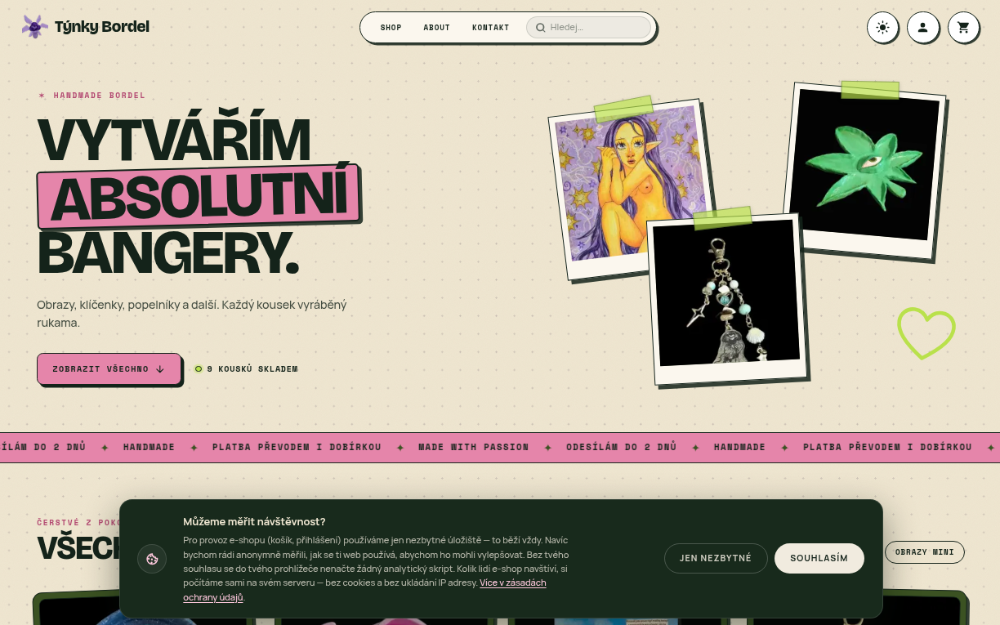

<div align="center">

# Týnky Bordel

**A handmade-goods e-shop for a Czech artist: paintings, keychains, ashtrays and more.**

[](https://nuxt.com)
[](https://vuejs.org)
[](https://www.typescriptlang.org)
[](https://tailwindcss.com)
[](https://www.postgresql.org)
[](https://orm.drizzle.team)
[](https://www.docker.com)
[](https://caddyserver.com)

**[Live site: tynkybordel.shop](https://tynkybordel.shop)**



</div>

## About

Týnky Bordel is a real, running online shop for one-of-a-kind handmade pieces. It covers the whole flow, from the storefront and checkout through order handling and invoicing to the shop owner's admin panel. The UI is in Czech and follows Czech consumer-protection and GDPR requirements.

## Features

- **Storefront** with categories, search, product galleries and sold pieces that stay visible (marked as sold) until taken down
- **Checkout** with Packeta (Zásilkovna) pickup points, cash on delivery and bank transfer with a scannable payment QR code
- **Accounts** via e-mail/password or Google sign-in (Better Auth), with order history and cancelling of unpaid orders
- **Invoices** issued through Fakturoid and e-mailed to the customer, plus PDF invoices generated with PDFKit
- **Admin panel** for products, orders, customers, e-mail templates, SMTP settings, editable homepage text and visitor stats
- **Privacy-friendly analytics**: visits are counted server-side without cookies or stored IPs; optional PostHog only after consent
- **Newsletter** with double opt-in, transactional e-mails over SMTP, PWA manifest and SEO (sitemap, robots)

## Tech stack

| Layer | Tools |
| --- | --- |
| Frontend | Nuxt 4, Vue 3, Nuxt UI, Tailwind CSS 4, Pinia |
| Backend | Nitro server routes, Better Auth, Drizzle ORM, PostgreSQL 17 |
| Integrations | Packeta, Fakturoid, Nodemailer, PayPal (prepared, currently off) |
| Infra | Docker Compose, Caddy (auto HTTPS), Cloudflare, GitHub Actions to GHCR |

## Getting started

```bash
cp .env.production.example .env   # fill in DB, auth and SMTP values
docker compose -f docker/docker-compose.yml up -d   # local Postgres on :5435 (reads docker/.env)
npm install
npm run dev                       # http://localhost:3000
npm run seed                      # optional: sample products
```

Production runs with `docker compose -f docker-compose.prod.yml up -d --build`. Database migrations apply automatically on boot. See [DEPLOY.md](DEPLOY.md) for the full VPS setup.

## Project structure

```
app/          pages, components, composables, Pinia stores
server/api/   REST endpoints (products, orders, auth, admin, newsletter)
server/utils/ e-mail, invoices, Fakturoid, analytics, rate limiting
server/database/  Drizzle schema, SQL migrations, seed scripts
shared/       shop config shared by client and server (fees, shipping)
docker/       local Postgres for development
Caddyfile     reverse proxy config for production
```
